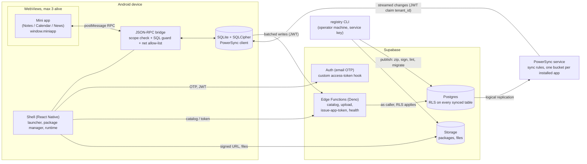
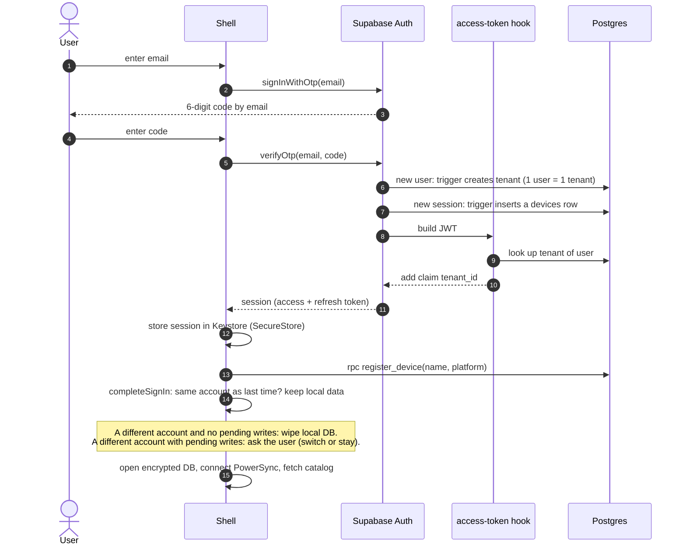
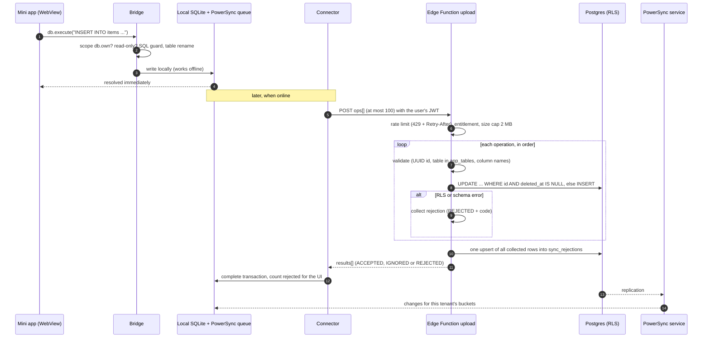

# Mina — an offline-first "super-app shell" with sandboxed mini apps

[](https://github.com/baoloc1993/mina/actions/workflows/check.yml)


Mina is an Android app (Expo / React Native) that works like a small app store and runtime in one: it downloads
**signed mini-app packages**, runs each one in a locked-down WebView, gives each one its own tenant-scoped tables in a
local encrypted SQLite database, and syncs those tables to **Supabase Postgres** through **PowerSync**. Mini apps never
touch the network, the database or the OS directly. They talk to the shell through a permission-checked JSON-RPC bridge
(`window.miniapp`).

This is a solo project, built and dogfooded on an Android emulator. The repo contains everything end to end: the
Supabase backend, a registry/ops CLI, the mobile shell, the mini-app SDK with a browser mock, three mini apps (Notes,
Calendar, News reader) and production deploy tooling. The UI text and most code comments are in Vietnamese, because
the three mini apps target a Vietnamese audience. Code identifiers, commits and this README are in English.

> **Honest status.** A working, tested vertical slice, not a launched product. I have no users, no store listing and no
> production deployment to point at. The deploy script and release-APK build exist and have unit tests, but I am not
> claiming a live environment. Limitations are listed in [Trade-offs and limitations](#trade-offs-and-limitations).

## What to look at in 2 minutes (backend view)

| Topic | Where |
|---|---|
| Multi-tenant isolation with RLS; `tenant_id` comes only from a signed JWT claim | [`backend/supabase/migrations/`](backend/supabase/migrations), pgTAP in [`backend/supabase/tests/rls.test.sql`](backend/supabase/tests/rls.test.sql) |
| Batched, idempotent upload endpoint (runs as the caller, so RLS applies) | [`functions/upload/`](backend/supabase/functions/upload) |
| Per-user rate limits in Postgres (fixed window, atomic upsert) | [`_shared/ratelimit.ts`](backend/supabase/functions/_shared/ratelimit.ts), `hit_rate_limit()` in the last migration |
| Mini-app registry: signed packages, additive-only migration linter, draft / tester / promote / revoke | [`backend/scripts/registry.ts`](backend/scripts/registry.ts), [`scripts/lib/`](backend/scripts/lib) |
| Structured JSON logs with request ids and secret redaction | [`_shared/log.ts`](backend/supabase/functions/_shared/log.ts) |
| Health endpoint and a production deploy script with preflight checks | [`health/`](backend/supabase/functions/health), [`deployment/prod/deploy.py`](deployment/prod/deploy.py) |
| Zero-trust bridge: scope matrix, SQL guard, network allow-list | [`mobile/src/bridge/`](mobile/src/bridge) |

## The idea

Small utilities (notes, a calendar, a news reader) are usually separate apps, each with its own account, sync and
install friction. A shell makes them cheaper to ship and safer to run:

- **One identity, one sync engine, one set of native services**, shared by every mini app (notifications, files,
  tags, contacts, intents between apps).
- **Mini apps are plain web bundles** (React + Vite here) that can be developed in a browser against a mock of the SDK.
- **A sandbox decides what a mini app may do.** A mini app declares scopes in its manifest. The bridge enforces
  them, and the user sees them before installing. Third-party code is therefore treated as untrusted by design.
- **Offline first.** The local database is the source of truth for the UI, and writes are queued and uploaded later.

## Features

**Backend (Supabase + Node CLI)**
- Postgres with row-level security on every synced table. One user maps to one tenant (MVP), and the `tenant_id`
  claim is injected into the JWT by a custom access-token hook.
- Email OTP sign-in. Google / Apple OAuth is wired in code and config, but disabled in release builds.
- Device list per tenant, with remote session revocation (`revoke_device` deletes the GoTrue session).
- Registry: apps, versions (`draft` → `published` → `revoked`), per-tenant testers, private apps owned by one tenant,
  per-app server config, and a catalog endpoint that returns signed download URLs.
- Entitlement: plan quota (`max_apps`, checked in `install_app`), expiry date and a configurable grace period, after
  which `upload` answers `403 READ_ONLY` for the whole batch.
- Edge Functions (Deno): `catalog`, `upload`, `issue-app-token`, `health`.
- `pg_cron` jobs that purge trashed notes, old news items and old rate-limit rows.
- Ops CLI: `ops:report`, `ops:backup-files`, `ops:verify-restore`, `smoke`.

**Mobile shell (Expo / React Native, TypeScript)**
- Launcher, catalog, install / update / rollback / uninstall, drag to reorder, account and device screens.
- Package manager: downloads a zip and checks SHA-256, an Ed25519 signature against keys from the server and the SDK
  semver range, extracts it safely, lints the manifest and migrations, runs them in SQLite, and keeps the previous
  version for rollback.
- Local store: SQLite with SQLCipher (random 32-byte key kept in the Android Keystore) plus the PowerSync client, with
  a dynamic schema built from the installed apps' migrations.
- Sync connector: batches of at most 100 operations, handling of 401 / 403 `READ_ONLY` / 429 with `Retry-After`,
  and a visible queue of rejected changes.
- Runtime: at most 3 live WebViews (LRU eviction with a `suspend` event), inter-app intents validated against JSON
  Schema (ajv), local notifications, a file cache with LRU eviction that never evicts files not yet uploaded, and a
  read-only mode driven by a monotonic clock so that rolling back the device clock does not extend a plan.

**Mini-app SDK**
- `window.miniapp` injected into the WebView, TypeScript typings, design tokens, and a **browser mock** (Vite + SQLite
  WASM) that runs the same bridge code, so a mini app can be developed without a phone.

**Mini apps** (each is a separate package built on the SDK)
- **Notes**: rich text and checklists (TipTap) stored as Yjs CRDT updates in a table, so two devices editing the same
  note merge without losing text. Accent-insensitive search, tags, attachments, trash with automatic purge, and
  reminders sent to Calendar through an intent.
- **Calendar**: events with recurrence, lunar-date display and lunar recurrence, exceptions per occurrence, and local
  notifications that are rescheduled to match the data.
- **News reader**: RSS / Atom parsing, sources the user approves host by host (`net.requestAccess`), read / saved
  state, and save-as-note or remind-me through intents.

## Architecture



How the pieces fit:

1. The operator publishes a package with the CLI. It zips the folder reproducibly (fixed order and mtime, so the same
   input gives the same SHA-256), signs the digest with Ed25519, uploads to Storage, lints the migrations, and applies
   them to Postgres. The CLI adds `tenant_id`, timestamps, RLS and triggers to each declared table, so a mini app
   cannot ship a table without isolation.
2. The shell fetches `catalog` (the response includes a signed URL), verifies the package, creates the app's tables in
   SQLite from the same migration files, and rebuilds the PowerSync schema.
3. PowerSync sync rules are **generated** from the registry (`gen-sync-rules`): one bucket per app, parameterised by
   `installations.enabled` and the `tenant_id` claim, never by anything the client sends.
4. A mini app calls `miniapp.db.execute(...)`. The bridge checks the scope, runs the SQL guard, rewrites table names,
   overwrites system columns, turns `DELETE` into a soft delete, and writes to local SQLite. PowerSync queues the change.
5. The connector uploads the queue to the `upload` Edge Function. The function uses the **caller's JWT**, not the service
   role, so the same RLS policies apply to uploads as to reads.

### Sign-in with email OTP



### Offline write and sync (including upload and rejections)



## Engineering highlights

- **RLS is the isolation boundary.** Every synced table has `tenant_id` and a `tenant_isolation` policy using
  `USING` and `WITH CHECK` on the JWT claim. Clients have no `DELETE` privilege, so deletes are soft. pgTAP tests
  switch to the `authenticated` role with another tenant's claims and assert zero reads, a failed cross-tenant
  insert (`42501`), zero updated rows and a refused hard delete.
- **Uploads run as the caller.** `upload` builds its Supabase client with the user's token, so `WITH CHECK` applies for
  real. `tenant_id` is always taken from the JWT, and `id`, `tenant_id` and timestamp columns sent by the client are
  ignored. PATCH or DELETE on a row that is missing and on a row that belongs to another tenant look the same
  (`FORBIDDEN`), so the endpoint does not reveal whether an id exists elsewhere.
- **Conflict semantics are explicit.** Last write wins per column, in server arrival order. A soft delete beats a
  later edit and cannot be resurrected through the SDK. Repeating a delete is idempotent. The one place where merging
  matters, the text of a note, uses a Yjs CRDT instead of last-write-wins.
- **Upload validation.** Operations must be `PUT | PATCH | DELETE` with a UUID id, a table that is registered in
  `app_tables`, and column names matching `^[a-z_][a-z0-9_]*$`. A body over 2 MB gets `413`. The size is counted while
  reading the stream, so chunked requests without `Content-Length` cannot use up memory. A batch is capped at 100
  operations; a code comment records that 500 parallel operations exceeded the edge runtime's CPU limit.
- **Sync rejection batching.** Bad operations are not fatal. They get a status and code in the response, and the
  function writes all of them to `sync_rejections` in a **single upsert** at the end (deduplicated on
  `tenant_id, table_name, row_id, op, code`, payload clipped to 4,000 characters). That keeps CPU flat for large
  batches and lets the UI show a rejected-changes list through normal sync.
- **Rate limits.** A fixed-window counter in Postgres (`hit_rate_limit`, one atomic `INSERT ... ON CONFLICT DO UPDATE`)
  per `function:user`. Defaults: upload 120 / min, catalog 30 / min, token 30 / min, overridable by env var. It counts
  before processing, so a `429` means nothing was applied and the client keeps its batch. Rejected calls still count,
  so spamming does not drain the limit. The client waits for `Retry-After`, clamped to 5-60 s. If the counter table
  fails, the limiter **fails open** and logs. Old rows are purged by an hourly `pg_cron` job.
- **Registry and package trust.** Versions must increase. The registry accepts only additive migrations:
  `CREATE TABLE IF NOT EXISTS`, `ALTER TABLE ... ADD COLUMN` (nullable or with a default) and `CREATE INDEX`. Tables must
  use the app's prefix, and dollar-quoting and quoted identifiers are rejected. Revoked versions cannot return. Trusted
  keys live in `signing_keys` (`active` / `retired`).
- **Entitlement without trusting the device clock.** The server sends `server_time` and the entitlement with each
  catalog call. The shell measures elapsed time with the monotonic clock and uses the wall clock only to detect
  rewinding. Past the grace period the shell turns every write method into `READ_ONLY` and the server refuses uploads.
- **Health endpoint.** `GET /functions/v1/health` is public and returns exactly `{ ok, db, version }` (HTTP 200 or 503).
  `version` is the git SHA set by the deploy script, which compares it with the local commit after deploying.
- **Deploy script and preflight** (`deployment/prod/deploy.py`). The steps are `preflight → link → db → secrets →
  functions → auth → registry → powersync → health → android`, with `--dry-run`, `--only <step>` and idempotent
  re-runs. Preflight refuses to run when: a required variable is missing; the URLs are not HTTPS or not the project's
  own; `DATABASE_URL` or `POWERSYNC_URL` point at localhost, a private range or `*.local`; the signing key id is not
  `prod-<n>`; the working tree under `backend/ mobile/ miniapps/ deployment/prod` is dirty; or `make check` fails.
  The `auth` step sets Auth options through the Supabase Management API (sign-up off, token hook on, OTP email
  template) and reads them back to confirm. Secrets are masked in printed commands. 18 unit tests cover the checks.
- **Signed release APK** (`mobile/scripts/release-android.mjs`). Production builds require HTTPS URLs and a real
  keystore, never fall back to the debug key, turn cleartext traffic off (it is enabled only with `--local`), run
  `apksigner verify`, and can pin the expected signing certificate's SHA-256 so a build with the wrong keystore is
  rejected. `versionCode` is minutes since 2026-01-01, so it always increases.
- **Structured logs.** Every Edge Function request logs one JSON line (`ts, level, fn, event, rid, method, status,
  ms`) and returns `x-request-id`. Keys that look like tokens, passwords, secrets or authorization headers are
  replaced with a placeholder, and long strings are cut.
- **Bridge hardening on the device.** The SQL guard is fail-closed. It accepts one simple statement on declared tables,
  and rejects `ATTACH`, `PRAGMA`, `UNION`, `WITH`, `RETURNING`, comments and quoted identifiers. A CSP with
  `connect-src 'none'` is injected into every mini app. `net.fetch` matches the exact `host[:port]` (no wildcards),
  follows redirects manually and re-checks every hop. The scope matrix test runs the real bridge against a fake host
  and asserts that a missing scope means zero host calls. The same expectations table is shared by the shell's Jest
  suite and the browser mock's Vitest suite.

## Trade-offs and limitations

- **Android only.** I built and ran it on an emulator. `app.json` has iOS settings, but I have not built or tested iOS.
  The release build targets `arm64-v8a` and `x86_64`.
- **Not a launched product.** Production deployment tooling exists, but nothing in this repo shows a live environment,
  real users or traffic. The "plan" model has a single row (`mvp-unlimited`) and no billing.
- **One user, one tenant.** There are no teams, shared workspaces or roles. Production sign-up is switched off by the
  deploy script, so accounts are created by the operator (`create-user`); locally anyone can sign up.
- **Sync conflicts.** Last-write-wins by server arrival order is simple, but an edit made earlier on a device that
  uploads later overwrites a newer edit to the same column. `updated_at` comes from the server clock (a trigger),
  never from the device. Only the Notes body is a CRDT.
- **Rate limiter.** Fixed windows allow a burst at a window boundary, and the limiter fails open if its table is
  unavailable. That is a deliberate availability choice, but it is a choice.
- **Operator-run deploys.** `make deploy` runs from the operator's machine with a service key and a personal access
  token. There is no automated deploy pipeline.
- **Sync rules are generated and must be pushed.** Publishing a new app with new tables changes
  `sync-rules.yaml`. Locally the PowerSync container must be restarted, and in production the rules are pushed by the
  `powersync` deploy step.
- **Intents are best-effort.** A payload larger than 64 KB, or one that fails the receiver's schema, is rejected.
  Delivery to a receiver that is not installed returns `INTENT_NO_HANDLER`.
- **Vietnamese UI and comments.** Mini-app text, many comments and the component READMEs are in Vietnamese.
- **`prototype/` is design material, not product code.** It holds static HTML mock-ups used for the screens, and the
  `hello` fixtures in `mobile/fixtures/` are test apps, not products.
- **Google / Apple sign-in** is wired but disabled in the release build (`EXPO_PUBLIC_OAUTH_PROVIDERS` empty by
  default), because no OAuth clients are configured.
- **Local dev builds allow cleartext HTTP** (the Expo config enables it for the Docker backend). The release script
  switches it off unless you pass `--local`.

## Data model overview

Platform tables (all in `public`, RLS enabled; clients get read-only access to their own tenant's rows, and writes
go through RPCs, Edge Functions or the service role):

| Table | Purpose |
|---|---|
| `tenants` | one per user (`owner_user_id`), `plan`, `entitlement_until` |
| `plans` | `max_apps` quota |
| `devices` | one row per auth session; `revoked_at` set on sign-out or revoke |
| `signing_keys` | public Ed25519 keys (`active` / `retired`) trusted by the shell |
| `apps`, `app_versions`, `app_version_testers` | registry: visibility (public or private to one tenant), version state, testers |
| `app_tables`, `app_migrations`, `intent_schemas` | what each app owns and declares |
| `app_configs` | server-side per-app config (no client access; delivered through `catalog`) |
| `installations` | which apps a tenant installed, `enabled`, launcher `position` |
| `sync_rejections` | changes the server refused, per tenant, shown in the shell |
| `core_tags`, `core_contacts`, `core_files`, `core_net_grants` | shared data and per-host network grants, synced per tenant |
| `rate_limits`, `app_opens_daily` | counters for rate limiting and usage |
| `app_<id>_<table>` | one set of tables per mini app, created from its migrations, for example `app_vn_app_note_notes` |

Every synced table has `id` (client-generated UUID), `tenant_id`, `created_at`, `updated_at` (server clock, set by
trigger) and `deleted_at`. Storage buckets: `packages` (signed zips) and `files` (private, objects under
`<tenant_id>/<file_id>`, 50 MB limit per file).

## SDK and bridge surface

Mini apps call `window.miniapp.*`. Every call is a JSON-RPC message that the bridge checks against the manifest
scopes first. TypeScript typings are in
[`mobile/packages/miniapp-sdk/src/index.d.ts`](mobile/packages/miniapp-sdk/src/index.d.ts) and the SDK README
(Vietnamese) has the full contract.

| Namespace | Methods | Scope required |
|---|---|---|
| `sdk` | `ready()`, `info()`, `on('suspend' \| 'resume' \| 'intent' \| 'sync' \| 'config', fn)` | none |
| `db` | `query(sql, params?, { includeDeleted? })`, `execute(sql, params?)`, `transaction([...])` (up to 100 statements) | `db.own` |
| `core.tags` | `list()`, `create()` | `core.tags:read` / `:write` |
| `core.contacts` | `search(q)`, `create()` | `core.contacts:read` / `:write` |
| `core.files` | `get(id)`, `list({ appId? })` | `core.files:read` |
| `intent` | `send(type, payload, { mode?, version? })` | `intent.send` + declared in `intents.sends` |
| `notify` | `schedule()`, `cancel(id)`, `list()` | `notify.local` |
| `storage` | `put()`, `get(fileId)`, `remove(fileId)` | `storage.files` |
| `net` | `fetch(url, opts)`, `requestAccess({ host, reason })` | `net` + `network[]` (and `net.user-approved` for `requestAccess`) |
| `ui` | `toast()`, `openUrl()`, `pickImage()`, `pickFile()`, `share()` | `ui.native` (+ `storage.files` for pickers) |
| `sync` | `status()` | none |
| `auth` | `getAppToken()` (short-lived HS256 JWT with `tenant_id` and `app_id`) | `auth.token` |

Errors are `Error` objects with a `.code`: `INVALID_REQUEST`, `SCOPE_DENIED`, `SQL_REJECTED`, `READ_ONLY`,
`OFFLINE`, `NOT_FOUND`, `INTENT_REJECTED`, `INTENT_NO_HANDLER`, `NET_BLOCKED`, `NET_ERROR`, `PERMISSION_DENIED`,
`APP_SUSPENDED`, `INTERNAL`.

**Backend HTTP surface** (Edge Functions under `/functions/v1/`):

| Function | Method | Auth | Notes |
|---|---|---|---|
| `catalog` | GET | user JWT | visible apps, latest safe version, signed package URL, entitlement, `server_time`; rate limited |
| `upload` | POST | user JWT | body `{ ops: [...] }`, at most 100 ops and 2 MB; `200` with per-op status, `403 READ_ONLY`, `413`, `429` |
| `issue-app-token` | POST | user JWT | body `{ app_id }`; only for installed and enabled apps; rate limited |
| `health` | GET | none | `{ ok, db, version }` |

## Tech stack

| Area | Technology |
|---|---|
| Backend | Supabase: PostgreSQL (RLS, `pg_cron`), Auth, Storage, Edge Functions on Deno; pgTAP |
| Sync | PowerSync (Open Edition with MongoDB for local; PowerSync Cloud for production) |
| Registry / ops CLI | Node.js + TypeScript (run directly with native type stripping), `pg`, `jose`, `fflate`, `@supabase/supabase-js` |
| Mobile shell | Expo 57 / React Native 0.86, TypeScript, `@op-engineering/op-sqlite` (SQLCipher), `react-native-webview`, `@noble/ed25519`, `ajv`, Jest |
| SDK + mock | TypeScript, design tokens, Vite + SQLite WASM, Vitest |
| Mini apps | React 19 + Vite, TipTap + Yjs (Notes), Vitest |
| Tooling | GNU Make, Docker Compose, Python 3 (seed and deploy scripts), GitHub Actions |

## Getting started

### Prerequisites

Docker, Node.js (I ran 24; the CLI needs native TypeScript stripping, so 23.6+), Python 3, GNU Make, Android Studio
with an emulator for the shell, and Deno (installed through `npm ci` in `backend/`). The first `make dev` runs
`npx supabase@latest`, so it needs internet access. No Supabase account is required for local work.

### Configuration

Copy the template and fill in local values; the comments in the file say what each one is. Names only are committed.
Real values live in `deployment/local/.env` and `deployment/prod/.env`, both ignored by git.

```bash
cp deployment/.env.example deployment/local/.env
```

| Variable | Used for |
|---|---|
| `SUPABASE_URL`, `SUPABASE_ANON_KEY` | client API endpoint and public key (the emulator reaches the host at `http://10.0.2.2:54321`) |
| `SUPABASE_SERVICE_ROLE_KEY` | operator scripts only (seed, publish); never bundled in the shell |
| `SUPABASE_JWT_SECRET` | PowerSync verifies session JWTs with it |
| `APP_TOKEN_SECRET`, `APP_TOKEN_TTL_SECONDS` | `issue-app-token` signs HS256 app tokens (default TTL 900 s) |
| `POWERSYNC_URL` | sync endpoint used by the shell |
| `DATABASE_URL` | the registry CLI applies migrations here (default: local Postgres on port `54322`) |
| `SIGNING_KEY_PATH`, `SIGNING_KEY_ID` | Ed25519 key for package signing (PEM, outside the repo; `make dev` generates `local-1`) |
| `PUBLIC_API_URL` | optional public API origin for signed download URLs |
| `ENTITLEMENT_GRACE_DAYS` | read-only grace period, default 7 |
| `FILE_CACHE_MAX_MB` | on-device file cache cap, default 200 |
| `RATE_LIMIT_UPLOAD_PER_MIN`, `RATE_LIMIT_TOKEN_PER_MIN`, `RATE_LIMIT_CATALOG_PER_MIN` | per-user limits (defaults 120 / 30 / 30) |
| `GOOGLE_OAUTH_CLIENT_ID`, `GOOGLE_OAUTH_CLIENT_SECRET`, `APPLE_CLIENT_ID`, `APPLE_CLIENT_SECRET` | optional OAuth; the Makefile sets dummy values locally |
| `EXPO_PUBLIC_OAUTH_PROVIDERS` | which OAuth buttons the shell shows; empty means OTP only |
| `SUPABASE_PROJECT_REF`, `SUPABASE_ACCESS_TOKEN`, `SUPABASE_DB_PASSWORD` | production deploy only |
| `POWERSYNC_INSTANCE_ID`, `POWERSYNC_ADMIN_TOKEN` | production: push sync rules to PowerSync Cloud |
| `ANDROID_KEYSTORE_PATH`, `ANDROID_KEYSTORE_PASSWORD`, `ANDROID_KEY_ALIAS`, `ANDROID_KEY_PASSWORD`, `ANDROID_CERT_SHA256`, `ANDROID_VERSION_CODE` | signed release APK |
| `GIT_SHA` | set by the deploy script; shown by `/health` |

### Make targets

| Target | What it does |
|---|---|
| `make help` | list targets |
| `make dev` | install backend deps, start Supabase (without Studio and other heavy services) and PowerSync + MongoDB in Docker, generate a local signing key, start Metro for the Android dev build |
| `make seed` | two test tenants (`a@test.local`, `b@test.local`), fixture apps published and installed, sample tags (needs `make dev` first) |
| `make mock FIXTURE=fixtures/miniapp-hello` | run a mini app in the browser against the SDK mock |
| `make check` | design tokens, typecheck of shell, SDK, mini apps and CLI, build of the three mini apps, `deno check` of the Edge Functions |
| `make test` | pgTAP, Deno tests, CLI tests, Jest, SDK and mini-app Vitest, Python deploy tests, release-script tests |
| `make accept` | HTTP acceptance scripts against a running local backend (after `make dev` and `make seed`) |
| `make migrate` | apply versioned migrations to the local database |
| `make keystore-local`, `make release-android-local` | local signing keystore and a signed release APK against the Docker backend |
| `make keystore-prod`, `make release-android` | production keystore and APK (needs `deployment/prod/.env`) |
| `make deploy DEPLOY_ARGS="--dry-run"` | preview the production deploy; see [`deployment/prod/README.md`](deployment/prod/README.md) |

The Makefile messages and comments are in Vietnamese. If `python` is not on `PATH`, pass it explicitly, for example
`make seed PYTHON=/c/path/to/python.exe`.

### Run the stack and the shell

```bash
cp deployment/.env.example deployment/local/.env   # then fill in values (see above)
make dev        # backend + sync + Metro; prints the API, PowerSync and mail URLs
make seed       # sample tenants and apps
# in another terminal, once, to build the dev client onto an emulator:
cd mobile && npx expo run:android
```

Sign in with `a@test.local` (or any email). Local OTP emails are captured by Mailpit at <http://127.0.0.1:54324>.
After editing an Edge Function, restart the runtime: `docker restart supabase_edge_runtime_platform-backend`.

### Mini apps

```bash
# Browser mock (no phone needed)
make mock FIXTURE=fixtures/miniapp-hello

# Build one of the real mini apps (writes dist/ with manifest, migrations, bundle)
cd miniapps/miniapp-note && npm ci && npm run build

# Publish: draft -> tester -> promote
cd ../../backend
npm run registry -- publish ../miniapps/miniapp-note/dist
npm run registry -- add-tester vn.app.note <version> a@test.local
npm run registry -- promote vn.app.note <version>
```

`python deployment/local/seed/seed.py --notes|--calendar|--news` installs those mini apps for both test tenants with
sample data. For the news reader, `python deployment/local/rss/serve.py` serves fake feeds for the emulator.
Other registry commands: `list`, `revoke`, `set-plan`, `set-entitlement`, `set-config`, `get-config`, `gen-sync-rules`
and `cron-check`.

## Testing

What each suite covers, and what I actually ran for this README (Windows 11, Node 24.15, Python 3.12):

| Suite | Command | Result when I ran it |
|---|---|---|
| Registry CLI: manifest, migration linter, signing, reproducible zips, sync-rules generation, ops helpers | `cd backend && npm ci && npm run test:cli` | 39 passed |
| CLI typecheck | `cd backend && npm run typecheck` | clean |
| Edge Function logic (Deno): upload semantics, rate limit, entitlement, catalog, log redaction, validation, health | `cd backend && npm run test:functions` | 41 passed |
| Deploy preflight and dry run | `python -m unittest deployment/prod/test_deploy.py` | 18 passed |
| Shell: bridge, scope matrix, SQL guard, package manager, entitlement, live set, intents, connector helpers | `cd mobile && npm ci && npx jest` | 287 passed (21 suites) |
| Shell typecheck | `cd mobile && npx tsc --noEmit` | clean |
| SDK and browser mock | `cd mobile && npm run test:sdk` | 91 passed |
| Release script | `cd mobile && node --test scripts/release-android.test.mjs` | 6 passed |
| Notes / Calendar / News | `cd miniapps/miniapp-<name> && npm ci && npm test` | 84 / 100 / 82 passed |
| pgTAP (RLS, platform, limits, grants, ops) | `make test` (runs `supabase test db`) | **not run** for this README (needs the Docker stack) |
| HTTP acceptance (`make accept`) | after `make dev` and `make seed` | **not run** for this README |

The unit suites need no Docker. GitHub Actions runs the cheap, dependency-light subset on every push (see
[`.github/workflows/check.yml`](.github/workflows/check.yml)): CLI tests, CLI typecheck, Deno function tests and the
Python deploy tests. It does not run the database, emulator or mobile suites.

## Project structure

```
backend/                 Supabase project and registry / ops CLI
  supabase/migrations/   versioned SQL: tenants, RLS, registry, devices, core data, entitlement, rate limits, cron jobs
  supabase/functions/    Edge Functions: catalog, upload, issue-app-token, health (+ _shared: auth, log, ratelimit, validate)
  supabase/tests/        pgTAP tests
  supabase/templates/    OTP email template
  powersync/             PowerSync config and generated sync rules
  scripts/               registry CLI, acceptance and smoke scripts, ops scripts (+ lib/ with unit tests)
mobile/                  Expo / React Native shell
  src/bridge/            JSON-RPC bridge, scope guard, SQL guard, network guard, shared expectations matrix
  src/packages/          package manager: verify, unzip, migrate, update, rollback
  src/store/             SQLite + SQLCipher, PowerSync schema, upload connector
  src/runtime/           session, catalog, live WebViews, intents, entitlement hooks
  src/native/            notifications, file store, net.fetch
  src/screens, src/ui/   screens and components
  packages/miniapp-sdk/  injected SDK, typings, design tokens, browser mock, tests
  fixtures/              test mini apps used by tests and the seed script
  scripts/               release APK build and keystore helper
miniapps/                mini apps built on the SDK
  miniapp-note/          Notes
  miniapp-calendar/      Calendar
  miniapp-news/          News reader
deployment/
  .env.example           variable names only
  local/                 docker-compose (PowerSync + MongoDB), seed script, fake RSS server
  prod/                  deploy script, its tests, runbook
prototype/               static HTML mock-ups of the shell and mini-app screens
Makefile                 dev / check / test / seed / mock / accept / migrate / deploy / release
```

More detail, in Vietnamese: [`backend/README.md`](backend/README.md), [`mobile/README.md`](mobile/README.md),
[`mobile/packages/miniapp-sdk/README.md`](mobile/packages/miniapp-sdk/README.md),
[`deployment/prod/README.md`](deployment/prod/README.md).

## Roadmap

Short and realistic, in the order I would do it:

1. Run pgTAP and the HTTP acceptance suite in CI (Supabase CLI in Actions) so the database layer is checked on every push.
2. Build and test on iOS, or drop the iOS config until then.
3. Translate the component READMEs and the Makefile messages to English, and add an i18n layer to the shell UI.
4. A real deployment (Supabase Cloud + PowerSync Cloud) with the health endpoint monitored, and a short write-up of
   what it showed.
5. Teams and shared workspaces (many users per tenant), which would need a membership table and changes to the RLS policies.

## License

[MIT](LICENSE)

## Author

**Ngo Le Bao Loc** — backend developer

- GitHub: [baoloc1993](https://github.com/baoloc1993)
- Email: baoloc1993@gmail.com
